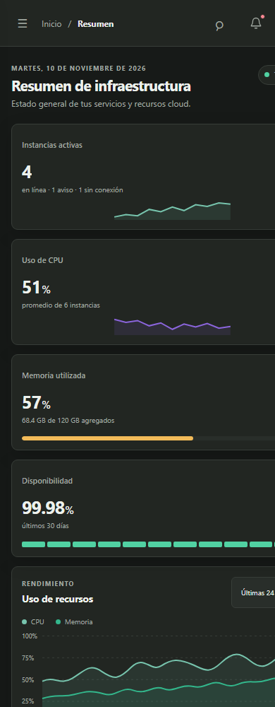
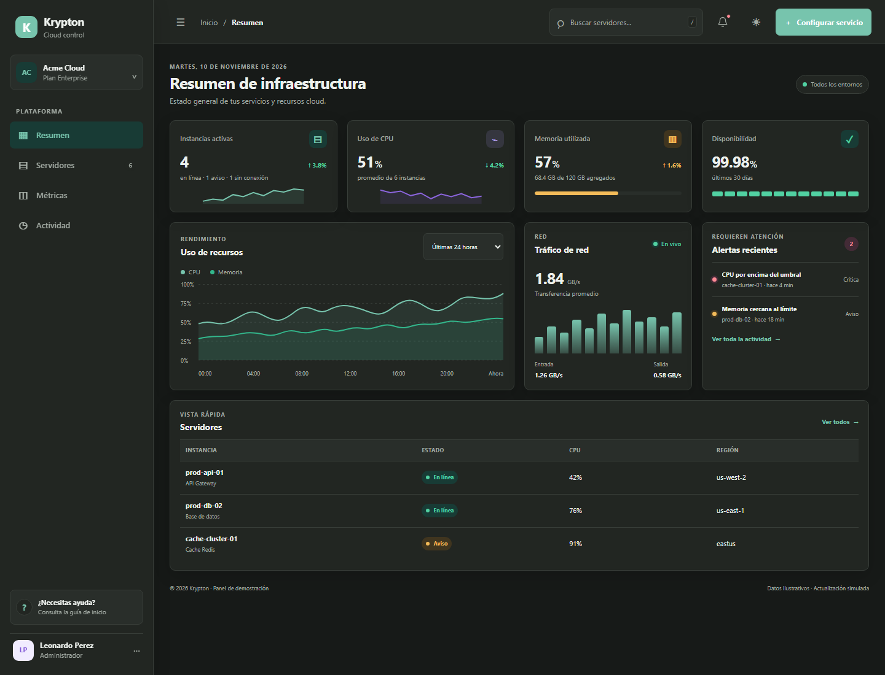

# Reporte técnico — Krypton

## 1. Datos del proyecto

- **Proyecto:** Krypton — panel de control de infraestructura cloud
- **Práctica:** Diseño de Interfaces Web · Mobile First
- **Responsable:** Leonardo Perez
- **Prototipo en Figma:** [Krypton Website](https://www.figma.com/design/OxIKSgDYvXnuPUq9Y2ERcw/Krypton-Website?node-id=0-1&t=RzdT2Z0N2MVuLdTt-1)
- **Tipo de entrega:** aplicación web de una sola página (SPA), ejecutada localmente

## 2. Objetivo y alcance

Krypton presenta una interfaz para consultar el estado de una infraestructura cloud desde un panel central. Reúne métricas, alertas, una lista de servidores y controles para buscar, filtrar y configurar instancias. La navegación cambia entre Resumen, Servidores, Métricas y Actividad sin recargar la página.

La implementación está realizada con HTML semántico, CSS nativo y JavaScript, sin frameworks ni dependencias externas. El diseño usa una paleta verde, tarjetas para agrupar indicadores y una distribución adaptable a distintos tamaños de pantalla.

**Alcance de la demostración:** los servidores, indicadores y alertas son datos de ejemplo. Guardar una configuración y reiniciar una instancia muestran estados y mensajes simulados en el navegador; estas acciones no se conectan con proveedores cloud ni modifican infraestructura real.

## 3. Estructura funcional

| Zona | Contenido y función |
|---|---|
| Navegación | Marca, espacio de trabajo, acceso a las cuatro secciones, ayuda y perfil de Leonardo Perez. |
| Barra superior | Ruta de navegación, búsqueda, acceso a actividad, cambio de tema y acceso a la configuración. |
| Contenido | Resumen con indicadores, gráficos y alertas; lista filtrable de servidores; y vistas de métricas y actividad. |
| Acciones | Panel lateral de configuración, confirmación antes de reiniciar, avisos de resultado y controles de tabla. |

La lista de servidores ofrece búsqueda, filtro por estado y paginación. El panel de configuración valida el formulario y muestra un estado de guardado; el reinicio requiere confirmación. También se puede alternar entre tema claro y oscuro.

## 4. Evidencia visual

Las imágenes corresponden a capturas locales de la página. La captura móvil muestra el flujo vertical en un ancho de teléfono; las capturas de escritorio muestran la composición completa y la paleta oscura.

### Escritorio

### Vista móvil

### Modo oscuro

## 5. Estados de los controles

La siguiente tabla resume cinco estados visuales y cómo comprobarlos en la interfaz:

| Estado | Evidencia y forma de reproducirlo |
|---|---|
| **Reposo** | Botones, enlaces, campos y selectores aparecen en su estado inicial, con el acento verde reservado para las acciones principales. |
| **Hover** | Al pasar el puntero sobre botones, enlaces de navegación y tarjetas, cambia el color, el fondo o la elevación para indicar que el elemento es interactivo. |
| **Focus** | Usa `Tab` para recorrer la interfaz. Los campos y selectores presentan un contorno de foco visible; el buscador resalta su borde al recibir el foco. |
| **Deshabilitado** | En Servidores, el botón **Anterior** está deshabilitado al inicio. En Configurar servicio, **Guardar cambios** se habilita al editar y los campos se deshabilitan temporalmente durante el guardado. |
| **Carga** | Edita un campo y guarda para ver **Guardando...**; en una instancia, inicia el reinicio y confirma para ver **Reiniciando...**. Al terminar, aparece un aviso de resultado. |

## 6. Revisión de las cinco dimensiones IxD

| Dimensión | Aplicación en Krypton | Revisión |
|---|---|---|
| **1. Palabras** | Etiquetas y mensajes como “Instancias activas”, “Sin conexión” y “Guardar cambios” explican el contenido y la acción. | ✓ Textos breves y en español; los formularios incluyen etiquetas accesibles. |
| **2. Representaciones visuales** | Tarjetas, gráficos, indicadores de estado, iconos y colores agrupan y distinguen la información. | ✓ Las métricas se muestran con valor, unidad y contexto; el color acompaña al texto de estado. |
| **3. Objetos físicos y espacio** | La barra lateral, la barra superior, las tablas, el panel lateral y el diálogo organizan el espacio de interacción. | ✓ La composición se adapta a pantallas estrechas y ofrece controles táctiles de tamaño cómodo. |
| **4. Tiempo** | Los gráficos representan tendencias de ejemplo; el guardado y el reinicio muestran una transición de carga y un aviso posterior. | ✓ La interfaz comunica espera y resultado; no representa telemetría en tiempo real. |
| **5. Comportamiento** | Búsqueda, filtros, navegación, paginación, configuración, confirmación, tema y atajos de teclado responden a acciones del usuario. | ✓ Las acciones principales tienen respuesta visible y el reinicio solicita confirmación. |

## 7. Validación realizada

- `node --check app.js`: sintaxis de JavaScript verificada.
- Navegación entre las cuatro vistas y sincronización de título y ruta verificadas.
- Búsqueda, filtro, paginación, formulario, confirmación de reinicio, avisos y cambio de tema verificados en navegador.
- Adaptación y desbordamiento horizontal comprobados en anchos de 320, 390, 768 y 1280 px.
- Navegación por teclado comprobada para `Escape` y el atajo `/` de búsqueda.

La verificación funcional se limita a la interacción en el cliente y a datos de muestra; no incluye pruebas de integración con un servicio cloud.

## 8. Archivos de entrega

- [index.html](./index.html): estructura y contenido de las vistas.
- [Styles.css](./Styles.css): estilos, paletas, estados y reglas responsivas.
- [app.js](./app.js): navegación e interacciones del cliente.
- [DESCRIPCION_FIGMA.md](./DESCRIPCION_FIGMA.md): descripción y guía visual para el prototipo.
- [Tablero de Krypton en Figma](https://www.figma.com/design/OxIKSgDYvXnuPUq9Y2ERcw/Krypton-Website?node-id=0-1&t=RzdT2Z0N2MVuLdTt-1).
